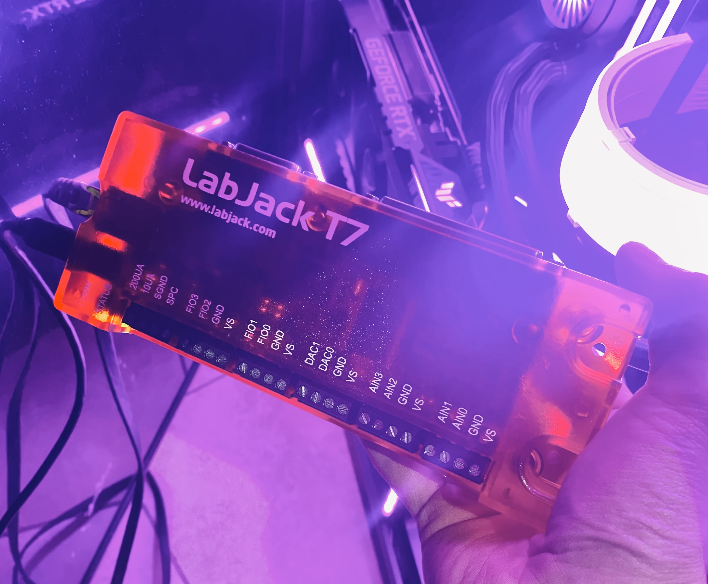

# LQD-DAQ
[](https://github.com/SunDevilRocketry/LQD-DAQ/actions/workflows/ci.yml)

Ground data acquisition and control for the LOX/IPA liquid engine test cart. It streams the cart's sensors from a LabJack T7, drives the valves, steppers and igniter, runs the fire and abort sequences, and serves it all over HTTP and SSE to the dashboard.



**Status:** the cart isn't wired yet. The code follows [the schematic](docs/schematics/legacy_cart_2026-10-16.pdf). Both main valves have no step counts yet, so `/fire` is refused. Running it natively is fine; a VM or container just keeps the install tidier.

## Run

```bash
bash Start_Linux.sh          # first run installs into .venv, then starts on :8000
bash Start_Linux.sh --mock   # simulated hardware, no T7 needed
```

On Windows, use `Start_Windows.bat` with the same flags. Without the LabJack LJM library the service refuses to start unless you pass `--mock`.

### Manual install (pyproject.toml)

The start scripts install from `requirements.txt`. To install the package yourself instead (Python 3.10+):

```bash
python3 -m venv .venv
.venv/bin/pip install -e ".[test]"   # drop [test] if you won't run the tests
.venv/bin/lqd-daq --mock             # same as: .venv/bin/python -m daq --mock
```

Run it from the repo root: `config.yaml` and the paths inside it are relative to the working directory. For real hardware, install LabJack's LJM driver as well (the start scripts link the right installer).

## Test

```bash
bash Start_Linux.sh --test        # mock-hardware suite, same as CI (installs requirements-dev.txt)
bash Start_Linux.sh --test-live   # bench only: needs a T7 plugged in
```

`--test-live` energises a valve only when you name it with `LQD_LIVE_ACTUATOR=<id>`. Never name one with gas connected.

## Layout

| Path | What's in it |
|---|---|
| `channels.yaml`, `actuators.yaml` | sensors and actuators, and the T7 pin for each |
| `config.yaml` | server, paths, mass-flow inputs, display thresholds |
| `daq/calibration.json` | per-channel slope and intercept |
| `sequences/` | `fire.yaml` and `abort.yaml` timelines (placeholders until Liquids confirms them) |
| `daq/` | engine, T7 driver and mock, API, logger |
| `tests/software/`, `tests/test_calculations.py` | mock-hardware tests |
| `tests/hardware_live/` | bench checks against a real T7 |
| `data/` | CSV recordings (git-ignored) |
